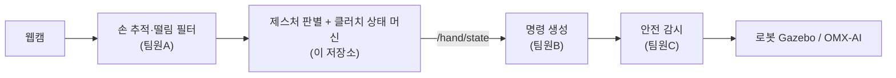

# 제스처 판별 모듈 (The-Hand)

손동작으로 로봇팔을 비접촉 제어하는 캡스톤 프로젝트(The-Hand 7조)에서 **제스처 판별·데이터·성능 평가** 파트입니다.
웹캠 손 랜드마크(MediaPipe 21점)를 받아 **"지금 로봇을 움직여도 되는지, 어떤 모드인지, 그리퍼를 열지 닫을지"**를 판단해 `/hand/state` 메시지 하나로 넘깁니다.



## 현재 상태 (2026-11-21)

| 단계 | 내용 | 상태 |
|---|---|---|
| 1~2 | `/hand/state` 형식, 제스처 후보 | 초안 완료, **팀 합의 대기** |
| 3~4 | 랜드마크 수집, 정규화·특징(78차원) | 완료 |
| 5 | 규칙 기반 판별기 | 완료, 11/21 첫 실측 튜닝 |
| 6 | 분류기 학습·비교 | 완료, 가짜 데이터로만 검증 |
| 7 | 클러치 상태 머신 | 완료, 11/21 손 끊김 0.3초 허용 |
| 8 | 평가 지표 | 완료, 실데이터 전 |
| 9 | ROS 2 노드 연동 | 미착수 (`LiveSession`이 노드 뼈대) |

테스트 61개 통과. 실측은 아직 야외·내장 웹캠·약 10 FPS 한 번뿐이라 실내 30 FPS 재측정이 남아 있습니다. 자세한 진행은 [구현 현황](docs/implementation_status.md)·[튜닝 기록](docs/tuning_log.md).

## 어디부터 보면 되나요?

| 이런 게 궁금하면 | 여기 |
|---|---|
| 코드가 어떻게 돌아가는지 처음부터 | **[코드 따라 읽기](docs/code_walkthrough.md)** — 프레임 하나가 `/hand/state`가 되기까지 순서대로 |
| 손 추적 결과를 어떤 형태로 넘기면 되는지 (팀원A) | [코드 따라 읽기 7절](docs/code_walkthrough.md#7-다른-파트와-맞닿는-곳) — 입력은 `(21,3)` 랜드마크 + 왼손/오른손 + 점수 |
| `/hand/state`에 뭐가 들어오고 어떻게 쓰면 되는지 (팀원B) | [hand_state_format.md](docs/hand_state_format.md) |
| 손이 안 보이거나 애매할 때 어떻게 멈추는지 (팀원C) | [코드 따라 읽기 5절](docs/code_walkthrough.md#5-상태-머신-언제-로봇을-움직여도-되는가) — 즉시 위치 고정, 0.3초 넘으면 PAUSED |
| 어떤 손 모양이 어떤 기능인지 | [gesture_candidates.md](docs/gesture_candidates.md) |
| 실제 손으로 해 보니 뭐가 문제였고 어떻게 고쳤는지 | [tuning_log.md](docs/tuning_log.md) |
| 남은 일정과 할 일 | [roadmap.md](docs/roadmap.md) |

**제스처 요약** (제안, 팀 합의 전): 손바닥 = 그리퍼 열림 · 주먹 = 닫힘 · V자 = 높이 모드 · 샤카(🤙) 0.5초 = 조작 시작/정지(클러치)

## 바로 실행해 보기 (Windows)

```powershell
git clone https://github.com/0514swkim-web/P_project.git
cd P_project
python -m venv .venv
.\.venv\Scripts\Activate.ps1
pip install -r requirements.txt

# MediaPipe 손 모델 (mediapipe 1.x는 Tasks API라 모델 파일이 필요)
curl.exe -L -o assets\hand_landmarker.task https://storage.googleapis.com/mediapipe-models/hand_landmarker/hand_landmarker/float16/latest/hand_landmarker.task

python scripts\check_env.py                # 환경 확인 (손에 점 21개가 그려지면 성공, q로 종료)
python -m pytest -q                        # 테스트 (웹캠 불필요)
python scripts\live_demo.py                # 실시간 데모 (내장 웹캠 = 0번, ZIO-C960 = --camera 1)
```

실시간 데모 화면: 왼쪽 위 = 모드·HOLD·클러치 게이지, 오른쪽 위 = 손가락별 각도 막대.
단축키 `c` 클러치 후보 전환 · `d` 손가락 상세 · `r` 초기화 · `q` 종료. 손은 카메라에서 50cm 이상, 밝은 곳에서 (어두우면 웹캠이 FPS를 낮춤).

<details>
<summary>데이터 수집·학습·평가 명령</summary>

```powershell
# 1) 수집 (영상은 저장하지 않고 랜드마크 CSV만)
python scripts\collect_landmarks.py --participant T01 --condition bright_front --camera 1
python scripts\collect_landmarks.py --participant T01 --camera 1 --labels nonop_drink,nonop_head,nonop_wave,nonop_phone,nonop_point,activate_call,activate_rock,activate_ok,activate_palm

# 2) 학습·비교 (규칙 vs 랜덤 포레스트 vs MLP, 참여자 단위 교차검증)
python scripts\train_classifier.py --data "data\raw\*.csv"

# 3) 평가 (정확도·F1, 오작동률, 활성화 실패율) — 최종 평가는 학습에 안 쓴 참여자로
python scripts\evaluate.py --data "data\raw\*.csv" --clutch call
python scripts\evaluate.py --data "data\raw\*.csv" --model models\gesture_clf.joblib

# 웹캠 없이 전체 흐름 시험 (가짜 데이터, 숫자는 의미 없음)
python scripts\make_synthetic_data.py
python scripts\train_classifier.py --data "data\synthetic\*.csv" --model-out models\synthetic_clf.joblib --results results\synthetic
```

</details>

## 코드 구조

| 파일 (`src/gesture/`) | 단계 | 역할 |
|---|---|---|
| [camera.py](src/gesture/camera.py) | 3 | 웹캠(MJPG) 열기, MediaPipe 손 인식 |
| [features.py](src/gesture/features.py) | 4 | 정규화(손목 원점·손바닥 크기·왼손 반전), 관절 각도, 특징 78차원 |
| [rules.py](src/gesture/rules.py) | 5 | 손가락 펴짐 패턴 → 제스처 + 신뢰도 |
| [state_machine.py](src/gesture/state_machine.py) | 7 | 안정화, 클러치 0.5초 토글, 높이 모드, 그리퍼, 손 끊김 |
| [pipeline.py](src/gesture/pipeline.py) | 4~7 | 위를 묶어 프레임 하나 → `HandState`(= `/hand/state`) |
| [live.py](src/gesture/live.py) | — | 실시간 처리 + 화면 표시 + 로그 (데모와 ROS 노드 공용) |
| [training.py](src/gesture/training.py) | 6 | 데이터셋 구성, 참여자 단위 교차검증, 판별 시간 |
| [evaluation.py](src/gesture/evaluation.py) | 8 | 오작동률, 활성화 실패율(95% 신뢰구간), 조건별 정확도 |
| [dataio.py](src/gesture/dataio.py) | 3 | 수집 CSV 형식, 참여자 그룹(T/S/E) |
| [synthetic.py](src/gesture/synthetic.py) | — | 테스트용 가짜 손 |

| 폴더 | 내용 |
|---|---|
| `scripts/` | 실행 스크립트 (데모, 수집, 학습, 평가, `setup/` WSL2 ROS 2 설치) |
| `tests/` | 테스트 (웹캠 불필요) |
| `docs/` | 문서 (아래 목록) |
| `data/`, `models/`, `results/`, `recordings/` | 수집 데이터·모델·결과·녹화 (개인정보·용량 때문에 저장소에 안 올림) |

## 문서

| 문서 | 내용 |
|---|---|
| [code_walkthrough.md](docs/code_walkthrough.md) | 코드 따라 읽기 |
| [hand_state_format.md](docs/hand_state_format.md) | `/hand/state` 메시지 형식 초안 |
| [gesture_candidates.md](docs/gesture_candidates.md) | 제스처 후보와 선정 기준 |
| [tuning_log.md](docs/tuning_log.md) | 실측 기반 규칙 튜닝 기록 |
| [implementation_status.md](docs/implementation_status.md) | 구현 현황·변경 기록 |
| [roadmap.md](docs/roadmap.md) | 전체 흐름, 남은 일정, 주차별 할 일 |
| [daily_log.md](docs/daily_log.md) | 날짜별 진행 기록 |
| [experiment_protocol.md](docs/experiment_protocol.md), [consent_form.md](docs/consent_form.md) | 실험 프로토콜·동의서 초안 |
| [dev_environment.md](docs/dev_environment.md) | 개발 환경 (Windows, WSL2 + ROS 2 Jazzy + Gazebo) |
| [implementation_plan.pdf](docs/implementation_plan.pdf), [requirements_check.pdf](docs/requirements_check.pdf) | 구현 계획, 요구사항 점검 |

## 환경 주의

- Python 3.11, 패키지 버전은 [requirements.txt](requirements.txt)에 고정.
- Windows 스마트 앱 컨트롤이 켜져 있으면 최신 DLL이 차단됨 → **pandas 2.3.3, matplotlib 3.10.9** 유지 (matplotlib 3.11.2면 `import mediapipe`부터 실패).
- OpenCV는 `opencv-contrib-python`만 설치 (`opencv-python`과 같이 깔면 충돌).
- mediapipe 1.x에는 예전 `mp.solutions.hands`가 없음 → `mediapipe.tasks.python.vision.HandLandmarker` 사용.
