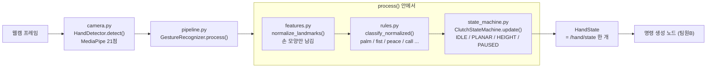
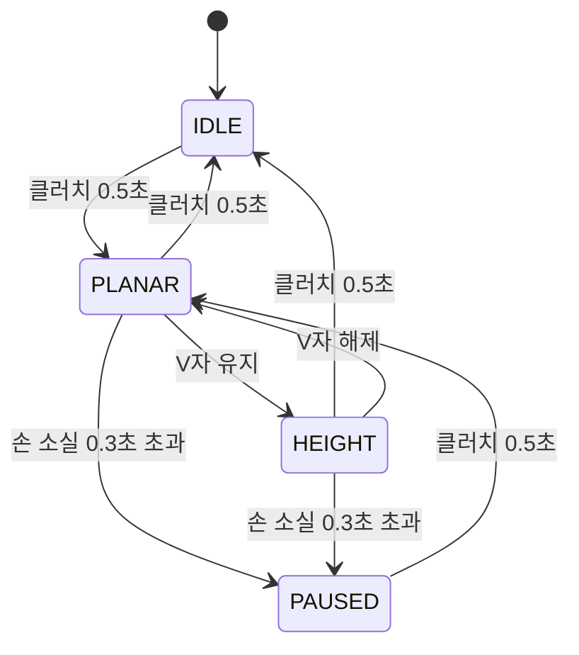

# 코드 따라 읽기: 웹캠 프레임 하나가 `/hand/state`가 되기까지

제스처 판별 모듈의 코드를 **데이터가 흐르는 순서대로** 설명합니다. 링크를 누르면 해당 함수로 바로 이동합니다 (11/21 기준 줄 번호).

> 처음이라면 [1. 한눈에 보기](#1-한눈에-보기)와 [7. 다른 파트와 맞닿는 곳](#7-다른-파트와-맞닿는-곳)만 읽어도 충분합니다.

## 목차

1. [한눈에 보기](#1-한눈에-보기)
2. [손 인식: 웹캠 → 랜드마크 21점](#2-손-인식-웹캠--랜드마크-21점)
3. [정규화: 손 모양만 남기기](#3-정규화-손-모양만-남기기)
4. [제스처 판별: 손가락 펴짐 패턴](#4-제스처-판별-손가락-펴짐-패턴)
5. [상태 머신: 언제 로봇을 움직여도 되는가](#5-상태-머신-언제-로봇을-움직여도-되는가)
6. [실시간 데모와 로그](#6-실시간-데모와-로그)
7. [다른 파트와 맞닿는 곳](#7-다른-파트와-맞닿는-곳)
8. [데이터 수집·학습·평가](#8-데이터-수집학습평가)
9. [자주 바꿀 곳](#9-자주-바꿀-곳)
10. [테스트로 동작 확인하기](#10-테스트로-동작-확인하기)

---

## 1. 한눈에 보기



| 단계 | 파일 | 핵심 함수 | 한 줄 요약 |
|---|---|---|---|
| 손 인식 | [camera.py](../src/gesture/camera.py) | [`HandDetector.detect`](../src/gesture/camera.py#L53) | 프레임 → 랜드마크 21점, 왼손/오른손, 인식 점수 |
| 정규화 | [features.py](../src/gesture/features.py) | [`normalize_landmarks`](../src/gesture/features.py#L65) | 위치·거리·좌우손과 무관한 손 모양으로 |
| 판별 | [rules.py](../src/gesture/rules.py) | [`classify_normalized`](../src/gesture/rules.py#L122) | 손가락 5개 펴짐(1)/접힘(0) → 제스처 이름 + 신뢰도 |
| 상태 머신 | [state_machine.py](../src/gesture/state_machine.py) | [`ClutchStateMachine.update`](../src/gesture/state_machine.py#L118) | 제스처 흐름 → 모드·위치 고정·그리퍼 |
| 묶음 | [pipeline.py](../src/gesture/pipeline.py) | [`GestureRecognizer.process`](../src/gesture/pipeline.py#L65) | 위 세 단계를 묶어 `HandState` 반환 |
| 실시간 | [live.py](../src/gesture/live.py) | [`LiveSession.step`](../src/gesture/live.py#L64) | 인식 + 판별 + 시간 측정 (데모·ROS 노드 공용) |

**설계 원칙 세 가지**

- **판단이 애매하면 정지.** 신뢰도가 낮으면 `none`, 손이 안 보이면 즉시 위치 고정.
- **클러치를 켜야만 움직임.** 평소 손동작(물 마시기, 머리 긁기)으로 로봇이 움직이지 않게 클러치 제스처를 0.5초 유지해야 조작이 켜짐.
- **ROS 없이 돌아가게.** 판별 로직은 순수 파이썬이라 웹캠 없이 테스트할 수 있고, ROS 2 노드는 `LiveSession`을 감싸기만 하면 됨.

## 2. 손 인식: 웹캠 → 랜드마크 21점

[`open_camera`](../src/gesture/camera.py#L17)가 웹캠을 MJPG로 엽니다. ZIO-C960 같은 USB 2.0 웹캠은 압축(MJPG) 없이는 큰 해상도에서 30 FPS가 안 나오기 때문입니다. Windows(DirectShow)에서는 MJPG를 해상도·FPS **다음에** 요청해야 적용됩니다(먼저 요청하면 ZIO-C960이 YUY2·5 FPS로 열림).
[`HandDetector.detect`](../src/gesture/camera.py#L53)는 MediaPipe Tasks API(`HandLandmarker`, 영상 모드)로 손 하나를 찾아 아래를 돌려줍니다.

| 값 | 형태 | 의미 |
|---|---|---|
| `landmarks` | `(21, 3)` 배열 또는 `None` | x, y = 화면 너비·높이로 나눈 좌표 [0, 1], z = 손목 기준 상대 깊이 |
| `handedness` | `"Left"` / `"Right"` | MediaPipe가 판단한 왼손/오른손 (왼손은 정규화 때 좌우 반전) |
| `score` | 0~1 | 손 인식 신뢰도 |

랜드마크 번호: 0 손목 · 엄지 1~4 · 검지 5~8 · 중지 9~12 · 약지 13~16 · 소지 17~20 (각 손가락의 첫 번호가 뿌리, 마지막이 끝).

> mediapipe 1.x에는 예전 `mp.solutions.hands`가 없습니다. 모델 파일 `assets/hand_landmarker.task`가 필요합니다 (README의 설치 명령).

## 3. 정규화: 손 모양만 남기기

같은 "주먹"이라도 화면 왼쪽/오른쪽, 카메라에서 가까이/멀리, 왼손/오른손에 따라 좌표가 다 다릅니다. [`normalize_landmarks`](../src/gesture/features.py#L65)는 이 차이를 지웁니다.

1. x·y 단위 맞추기 (화면 가로세로 비율 보정)
2. 손목을 원점으로 이동 → **화면 위치와 무관**
3. 손바닥 크기(손목~중지 뿌리 거리)로 나누기 → **카메라 거리와 무관**. 이후 거리 숫자는 "손바닥 크기 = 1" 단위
4. 왼손이면 x 부호 반전 → **왼손을 오른손 모양으로 통일**

[`joint_angles`](../src/gesture/features.py#L96)는 손가락마다 관절 3개의 꺾인 각도를 구합니다 (일직선 180°, 많이 접을수록 작아짐).
분류기용 특징 [`feature_vector`](../src/gesture/features.py#L111)는 정규화 좌표 63개 + 관절 각도 15개 = **78차원**입니다.

로봇을 움직일 손 위치는 [`palm_center`](../src/gesture/features.py#L56)(손목 + 손가락 뿌리 4개 평균)를 씁니다. 손가락을 쥐었다 펴도 거의 안 움직이는 점들이라, 그리퍼 동작 때문에 로봇 위치가 흔들리지 않습니다.

## 4. 제스처 판별: 손가락 펴짐 패턴

[rules.py](../src/gesture/rules.py)는 학습 없이 규칙으로 판별합니다. 분류기(랜덤 포레스트·MLP)와 비교하는 기준선 역할도 합니다.

**① 손가락마다 펴짐/접힘** ([`finger_margins`](../src/gesture/rules.py#L90))

- 검지~소지: 두 관절(PIP·DIP) 각도 평균이 **150°보다 크면 펴짐**
- 엄지: 각도가 140°보다 크고 **그리고** 엄지끝(4)이 검지 뿌리(5)에서 **0.75 이상 떨어져 있으면 펴짐** ([`thumb_state`](../src/gesture/rules.py#L74)).
  11/21 실측에서 엄지는 각도로는 거의 구분이 안 되고 거리로 구분됐습니다 (접힘 0.24~0.56, 펴짐 0.97~1.45). 자세한 근거는 [tuning_log.md](tuning_log.md).

**② 패턴을 표와 맞추기** ([`GESTURE_PATTERNS`](../src/gesture/rules.py#L20)). 순서는 (엄지, 검지, 중지, 약지, 소지), `None`은 상관없음.

| 제스처 | 패턴 | 역할 (제안) |
|---|---|---|
| `palm` 손바닥 | 1 1 1 1 1 | 그리퍼 열림 |
| `fist` 주먹 | 0 0 0 0 0 | 그리퍼 닫힘 |
| `peace` V자 | ? 1 1 0 0 | 높이 모드 |
| `call` 샤카 | 1 0 0 0 1 | 클러치 (시작·정지) |
| `rock` 락 | 0 1 0 0 1 | 클러치 후보 2 |
| `ok` OK | 엄지 펴짐 + 엄지끝·검지끝 맞닿음 + 중지·약지·소지 펴짐 | 클러치 후보 3 |
| `like` 엄지 척 | 1 0 0 0 0 | 없음 |
| `one` 검지 | 0 1 0 0 0 | 비조작 동작 (가리키기) |
| `none` | 위에 안 맞거나 신뢰도 0.3 미만 | 아무것도 안 함 |

**③ 신뢰도** ([`classify_normalized`](../src/gesture/rules.py#L122)): 그 제스처를 정하는 데 쓴 손가락 중 **가장 애매한 손가락**이 임계값에서 얼마나 떨어져 있는지 (0~1). 한 손가락이라도 임계값 근처면 판별 전체를 믿기 어렵다는 뜻입니다. `?`(상관없음) 손가락은 계산에서 뺍니다.
[`GestureRecognizer.process`](../src/gesture/pipeline.py#L65)는 신뢰도 0.3 미만을 `none`으로 바꿉니다.

**분류기로 바꿔 끼우기**: `GestureRecognizer(classifier=모델)`을 주면 규칙 대신 학습 모델이 같은 자리에서 판별합니다 ([`_classify`](../src/gesture/pipeline.py#L56)). 상태 머신 이후는 그대로입니다.

## 5. 상태 머신: 언제 로봇을 움직여도 되는가

제스처는 프레임마다 흔들리므로, 바로 로봇 명령으로 쓰지 않고 [`ClutchStateMachine.update`](../src/gesture/state_machine.py#L118)가 시간 흐름을 보고 판단합니다.



`update()`는 코드 안 주석 번호 순서대로 읽으면 됩니다.

| 코드 | 하는 일 |
|---|---|
| [1) 손 소실](../src/gesture/state_machine.py#L120) | 손이 안 보이면 **즉시 위치 고정**. 0.3초 안에 돌아오면 모드 유지, 넘으면 PAUSED (재개는 클러치) |
| [2) 클러치 유지 시간](../src/gesture/state_machine.py#L137) | 클러치가 0.5초 이어졌는지. 중간에 0.15초 이하로 끊긴 건 유지로 봄 |
| [3) 대기·일시정지](../src/gesture/state_machine.py#L150) | IDLE/PAUSED에선 클러치만 봄 → 0.5초면 PLANAR |
| [4) 활성 중 클러치](../src/gesture/state_machine.py#L157) | 클러치가 보이는 순간 바로 위치 고정 (정지 의도가 늦게 반영되지 않게), 0.5초면 IDLE |
| [5) 평면 ↔ 높이](../src/gesture/state_machine.py#L165) | V자가 안정되면 HEIGHT. 진입 시점 손 높이 대비 변화량이 `height_input` |
| [6) 그리퍼](../src/gesture/state_machine.py#L176) | 손바닥 = 열림, 주먹 = 닫힘. 바뀌는 중에는 위치 고정 (잡는 순간 흔들림 방지) |

- **토글**: 같은 클러치로 켜고 끕니다. 한 번 전환한 뒤엔 손을 풀었다가 다시 해야 다음 전환 (계속 들고 있으면 껐다 켰다 반복되는 것 방지).
- **안정화** ([`_stable`](../src/gesture/state_machine.py#L97)): 모드·그리퍼 전환은 같은 제스처가 3프레임 연속일 때만 인정합니다.
- 수치는 모두 [`ControlConfig`](../src/gesture/state_machine.py#L59) 한 곳에 있습니다.

## 6. 실시간 데모와 로그

[`LiveSession.step`](../src/gesture/live.py#L64)은 프레임 하나에 대해 손 인식 → `process()`를 돌리고, 인식 시간·판별 시간을 잽니다 (11/21 내장 웹캠 실측: 인식 약 16ms, 판별 약 0.035ms).
카메라 루프와 분리돼 있어, 검출기 자리에 가짜 객체를 넣으면 웹캠 없이 테스트됩니다 ([test_live.py](../tests/test_live.py)).

[scripts/live_demo.py](../scripts/live_demo.py)는 이걸 화면에 띄웁니다. 왼쪽 위에 모드·HOLD·클러치 게이지, 오른쪽 위에 손가락별 각도 막대가 나옵니다 ([`draw_overlay`](../src/gesture/live.py#L149)).

```powershell
python scripts\live_demo.py --camera 1                       # ZIO-C960 = 1번, 내장 = 0번
python scripts\live_demo.py --clutch rock                    # 클러치 후보 바꿔 보기
python scripts\live_demo.py --record recordings\X.mp4 --log recordings\X.csv   # 화면 녹화 + 프레임별 수치
```

단축키: `c` 클러치 후보 전환(call → rock → ok → palm) · `d` 손가락 상세 · `r` 초기화 · `q` 종료.
`--log` CSV에는 프레임마다 `/hand/state` 필드와 손가락 원시 값(엄지 거리, 각도 등)이 저장돼, 임계값을 다시 맞출 때 씁니다 ([`state_row`](../src/gesture/live.py#L87)).

## 7. 다른 파트와 맞닿는 곳

**팀원A (손 추적·필터) → 제스처**

- 제스처 모듈이 받는 입력은 `(21, 3)` 랜드마크 + `"Left"/"Right"` + 인식 점수 하나뿐입니다 ([`process`](../src/gesture/pipeline.py#L65)의 인자).
- 필터를 거친 랜드마크를 그대로 넣으면 되고, `LiveSession`은 `.detect(frame, t) → (landmarks, handedness, score)`만 있으면 어떤 검출기든 받습니다. 함수 호출로 붙일지 `/hand/landmarks` 토픽으로 나눌지는 합의가 필요합니다.

**제스처 → 팀원B (명령 생성)**

- 출력은 [`HandState`](../src/gesture/pipeline.py#L14) = `/hand/state` 메시지의 파이썬 버전입니다. 필드 정의와 명령 생성 노드가 할 일(제안)은 [hand_state_format.md](hand_state_format.md).
- 요약: `control_mode`가 PLANAR면 `position` 변화량으로 좌우·전후, HEIGHT면 `height_input`으로 상하, `hold_position`이 true면 모드와 관계없이 정지.

**제스처 → 팀원C (안전)**

- 손 소실 처리: **즉시 `hold_position=true`**, 0.3초 넘으면 PAUSED. 원래 계획서의 "손 소실 → 일시정지"를 실측(짧은 인식 끊김이 잦음)에 맞춰 구체화한 것이라 확인이 필요합니다.
- 명령 생성 쪽에서 `/hand/state`가 0.2초 이상 안 오면 정지하는 것도 제안돼 있습니다.

## 8. 데이터 수집·학습·평가

| 하는 일 | 스크립트 | 코드 |
|---|---|---|
| 수집 (영상 없이 랜드마크 CSV만) | [collect_landmarks.py](../scripts/collect_landmarks.py) | [dataio.py](../src/gesture/dataio.py) |
| 규칙 vs 랜덤 포레스트 vs MLP 비교 | [train_classifier.py](../scripts/train_classifier.py) | [`cross_validate`](../src/gesture/training.py#L67) — 참여자 단위로 나눠(GroupKFold) 같은 사람이 학습·평가에 동시에 안 들어감 |
| 오작동률·활성화 실패율 | [evaluate.py](../scripts/evaluate.py) | [`control_metrics`](../src/gesture/evaluation.py#L56) — 기록을 상태 머신에 그대로 재생해서 셈 |
| 조건별 정확도·F1 | 〃 | [`gesture_metrics`](../src/gesture/evaluation.py#L105) |

- 참여자 ID 첫 글자로 그룹을 나눕니다: T(팀원) · S · E(최종 평가용, 학습에 안 씀).
- `--clutch palm`은 "손바닥 유지 = 활성화" 베이스라인입니다. 같은 데이터로 클러치 설계의 효과를 비교합니다.
- `data/synthetic`, `results/synthetic`는 코드 동작 확인용 **가짜 데이터**라 숫자에 의미가 없습니다.

## 9. 자주 바꿀 곳

| 바꾸고 싶은 것 | 고칠 곳 |
|---|---|
| 클러치·그리퍼·높이 제스처 배정 | [`default_roles()`](../src/gesture/state_machine.py#L35) 한 곳 (실행 중엔 데모에서 `c`) |
| 손가락 펴짐 임계값, 엄지 거리, OK 거리 | [`RuleConfig`](../src/gesture/rules.py#L34) |
| 클러치 유지 0.5초, 끊김 허용, 안정화 프레임, 손 소실 0.3초 | [`ControlConfig`](../src/gesture/state_machine.py#L59) |
| 새 제스처 추가 | [`GESTURE_PATTERNS`](../src/gesture/rules.py#L20)에 패턴 한 줄 + 테스트 |

임계값을 바꿨다면 문제 → 원인(수치) → 수정 → 전후 비교를 [tuning_log.md](tuning_log.md)에 남깁니다.

## 10. 테스트로 동작 확인하기

```powershell
python -m pytest -q        # 웹캠 없이 전부 실행 (61개)
```

테스트 이름이 곧 동작 명세라, 규칙이 궁금할 때 테스트부터 보는 게 빠릅니다.

| 파일 | 확인하는 것 (예) |
|---|---|
| [test_rules.py](../tests/test_rules.py) | 제스처별 판별, 왼손·회전, 실측 엄지 값, 엄지 편 V자, OK 오판 방지 |
| [test_state_machine.py](../tests/test_state_machine.py) | 0.5초 미만 클러치는 무시, 토글은 손을 풀어야 다음 전환, 손 잠깐 끊김은 모드 유지, 0.3초 넘으면 PAUSED |
| [test_features.py](../tests/test_features.py) | 정규화가 위치·크기·좌우손에 무관한지 |
| [test_live.py](../tests/test_live.py) | 가짜 검출기로 실시간 처리·로그 |
| [test_baseline_and_groups.py](../tests/test_baseline_and_groups.py), [test_end_to_end.py](../tests/test_end_to_end.py) | 베이스라인, 참여자 그룹, 수집 → 학습 → 평가 전체 흐름 |
