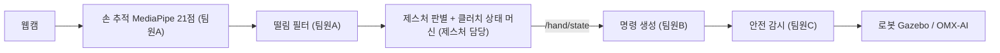
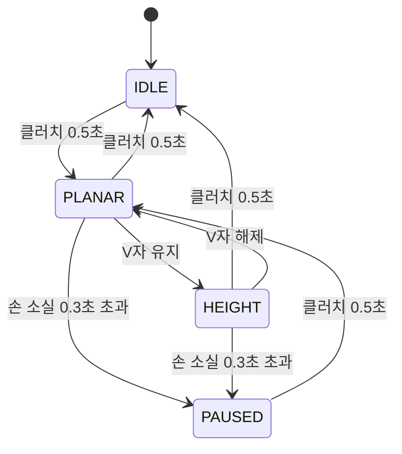

# P프로젝트 구현 현황

The-Hand 7조 · 제스처 판별·데이터·성능 평가 파트(제스처 담당)의 **진행 상황과 변경 이력**.

- **노션 "P프로젝트 구현 현황" 페이지와 같은 내용을 유지한다.** 한쪽을 고치면 다른 쪽도 맞춘다.
- 구현에 변화가 생기면 맨 아래 **변경 기록**에 한 줄씩 쌓고, 위의 현재 상태를 갱신한다.
- 튜닝처럼 근거가 긴 기록의 원본은 `docs/tuning_log.md`. 구조·메시지 형식·규칙 설명은 아래 **모듈 참고**.
- 노션: https://app.notion.com/p/41fc48ace945811c8e85fc5aaa67737d
- GitHub: https://github.com/0514swkim-web/P_project (공개, 11/21부터. 코드·문서만, 영상·데이터·모델 제외. 공개본 문서는 실명 대신 팀원A·B·C·제스처 담당으로 표기)
- 전체 흐름·남은 일정·진행 방법은 `docs/roadmap.md` (노션 하위 페이지 **전체 흐름과 앞으로 할 일**).
- 날짜별 진행 기록은 `docs/daily_log.md` (노션 이 페이지 맨 아래 **일일 진행 기록** 데이터베이스와 같은 내용).

## 현재 상태

마지막 갱신 2026-11-24 · 테스트 62개 통과 · 최종 제출 2026-12-13

| 단계 | 내용 | 상태 |
| --- | --- | --- |
| 1 | `/hand/state` 형식 | 초안 완료, 팀 합의 대기 |
| 2 | 클러치·높이 제스처 후보 | 초안 완료. 11/21 V자를 엄지와 무관하게 변경. 클러치는 비조작 동작 비교로 확정 예정 |
| 3 | 랜드마크 수집 스크립트 | 완료, 본 수집 전 |
| 4 | 전처리·특징 추출 (78차원) | 완료 |
| 5 | 규칙 기반 판별기 | 완료. 11/21 첫 실측 튜닝(엄지·OK·신뢰도 계산) |
| 6 | 분류기 학습·비교 | 완료, 가짜 데이터로만 검증 |
| 7 | 안정화·클러치 상태 머신 | 완료. 11/21 짧은 손 끊김(0.3초) 허용 추가 |
| 8 | 평가 지표 | 완료, 실데이터 전 |
| 9 | ROS 2 노드 연동 | 미착수. `live.py`가 노드 뼈대 역할, WSL2 Gazebo 시뮬 준비됨 |

**실측 환경 현황**: 지금까지 손 실측은 야외·내장 웹캠·약 10 FPS 한 번뿐 (참여자 T01). 11/24 ZIO 웹캠 확보, 실내에서 1280×720 MJPG 30 FPS 확인, 실시간 데모(손 인식 포함)도 약 30 FPS.

**실내 녹화 현황 (11/24, `docs/recording_guide.md`)**: A ✅ 도서관 재녹화 (9개 중 6개 의도대로, 손바닥·엄지 척·OK 실패) · B ⏳ 덮어써짐, 집에서 재녹화 · C ✅ C1~C3 한 파일(`T01_C_indoor_mixed`), C4 조명 미실시 · D·E·F ⏳ 집에서

## 규칙 튜닝

실제 손으로 녹화·측정하고 규칙 판별기와 상태 머신을 고친 기록. 각 회차의 상세(문제 → 원인(수치) → 수정 → 전후 비교 → 캡처)는 `docs/tuning_log.md`와 노션 변경 기록의 해당 항목 페이지("규칙 튜닝" 탭).

| 회차 | 날짜 | 조건 | 고친 것 | 결과 |
| --- | --- | --- | --- | --- |
| #1 야외 첫 실측 | 2026-11-21 | 야외·내장 웹캠·약 10 FPS, T01 | P1 엄지 거리 0.6→0.75 · P2 엄지 신뢰도 계산 · P3 V자 엄지 무관 · P4 OK 조건 · P5 손 끊김 0.3초 허용 | 고른 25프레임 기준 의도대로 판정 7 → 20 (정확도 지표 아님). 남은 문제 R1~R4. 캡처 `recordings/captures/T01_00_overview.png` |

## 열린 문제

| # | 문제 | 수치 | 다음 조치 |
| --- | --- | --- | --- |
| R1 | 주먹을 옆으로 돌리거나 엄지를 바깥에 감싸면 엄지 척과 구분 안 됨 | 엄지 거리 0.70~1.61 | 프로토콜에 "주먹은 손등이 카메라를 향하게, 엄지는 안으로" 명시 |
| R2 | V자에서 약지·소지를 덜 접으면 신뢰도 낮음 | 약지·소지 141~149° (임계값 150°). 11/24 실내 A는 확실히 접어 98~112°, 신뢰도 0.76 | 프로토콜에 "약지·소지 확실히 접기" |
| R3 | OK에서 약지·소지가 덜 펴지면 신뢰도 낮음 | 157° (여유 0.23). 11/24 실내는 168~175°로 문제없음 → OK 실패 원인은 R5 | R5와 같이 처리 |
| R4 | 야외 10 FPS | **11/24 해결**: 실내 ZIO 카메라 30.3 FPS, 손 인식 포함 약 30 FPS (A 녹화 평균 30, 인식 약 10ms) | 어두운 곳 FPS는 C4에서 확인 |
| R5 | 엄지 거리가 손 각도·카메라 위치에 따라 크게 달라 엄지가 들어간 손 모양이 실패 (11/24 실내 A) | 손바닥 엄지 0.69~0.80 (야외 0.97~1.45, 임계값 0.75) → none · 엄지 척 0.81~0.83 → 신뢰도 0.2 · OK 엄지 0.54~0.67 → 엄지 접힘이라 OK 조건 불통과. 멀거나 옆 각도 샤카 0.75~0.82 | B 녹화 후 튜닝 #2: 손바닥 엄지 무관(`?1111`), OK 조건을 엄지 대신 검지 반쯤 굽힘(OK 131~139° vs 꽉 접음 약 95°)으로, 엄지 거리 임계값 재검토 |

## 팀 공유 필요

- [ ] 손 소실 규칙 구체화: "손 소실 → 일시정지"를 "즉시 위치 고정, 0.3초 넘으면 일시정지"로 (안전 담당 팀원C와 확인)
- [ ] `/hand/state` 형식 합의 (팀원A 데이터 포맷 초안과 통합)
- [ ] Windows 환경이면 matplotlib 3.10.9 사용 (스마트 앱 컨트롤이 3.11.2 차단 → mediapipe 실행 불가)

**합의가 필요한 질문** (`/hand/state` 형식과 함께)

1. 클러치 상태 머신을 인식부(제스처 노드)에서 돌릴지, 제어부에서 돌릴지
2. 좌표 단위: 정규화 좌표 [0,1] (제안) vs 픽셀
3. `height_input`을 인식부에서 계산할지, 제어부가 `position.y`로 직접 계산할지
4. QoS: `BEST_EFFORT` + `KEEP_LAST(1)` 제안
5. 팀원A(손 추적·필터) → 제스처: 같은 노드에서 함수 호출 vs `/hand/landmarks` 토픽 분리
6. `hand_interfaces` 메시지 패키지 담당과 저장소 위치
7. mediapipe 버전을 1.2.2(Tasks API)로 맞출지 (Ubuntu Python 3.12 설치 확인 필요)
8. 비조작 동작 프레임을 분류기 학습에서 빼는 것 (손 흔들기 = 손바닥 모양이라 `none` 라벨과 충돌). 계획서 방식은 옵션(`--nonop-as-none`)으로 남겨둠

## 다음 할 일

- [ ] B 재녹화 (집, 11/24 추가한 9·10번 포함) → 튜닝 #2 (R5)
- [ ] D·E·F 녹화 (집), C4 조명 조건은 조명 바꿀 수 있는 곳에서
- [ ] 팀원 데이터 수집 → 분류기 학습·규칙과 비교
- [ ] 클러치 후보 확정
- [ ] ROS 2 노드로 감싸기 (`/hand/state` 발행), WSL2 Gazebo 시뮬과 연동
- [ ] 엄지 판정 방식 재검토 (거리 하나로는 각도에 약함, R5)
- [ ] 실험 프로토콜·동의서 초안 팀 공유 (`docs/experiment_protocol.md`, `docs/consent_form.md`). R1·R2 촬영 자세 문구 반영

## 모듈 참고

제스처 모듈은 웹캠 손 좌표(MediaPipe 21점)를 받아 **"지금 로봇을 움직여도 되는지, 어떤 모드인지, 그리퍼를 열지 닫을지"**를 판단해 `/hand/state` 한 메시지로 넘긴다. 가짜 데이터로 나온 숫자는 동작 확인용이라 이 문서와 보고서에 쓰지 않는다. (11/21 노션 구 페이지 "제스처 판별 모듈 구현 현황"을 옮겨 오며 11/21 튜닝 기준으로 갱신)

### 전체 흐름

제스처 모듈은 손 추적·필터(팀원A)와 명령 생성(팀원B) 사이에 들어간다. 인식부와 제어부는 `/hand/state` 하나로만 연결된다.



### /hand/state 메시지 형식 (초안 v0.1)

카메라 프레임마다(약 30 Hz) 발행. 명령 생성 노드는 0.2초 동안 수신이 없으면 일시정지. 패키지명 제안 `hand_interfaces/msg/HandState.msg`. 전체 초안은 `docs/hand_state_format.md`.

| 필드 | 타입 | 의미 |
| --- | --- | --- |
| `header` | std_msgs/Header | stamp = 프레임 캡처 시각 (지연 측정 기준) |
| `frame_index` | uint32 | 프레임 번호 (누락 확인) |
| `hand_detected` | bool | 손이 인식됐는가 |
| `handedness` | string | "Left" / "Right" (거울 반전 후) |
| `detection_confidence` | float32 | MediaPipe 손 인식 신뢰도 [0,1] |
| `position` | geometry_msgs/Point | 손 기준점(손목 + 손가락 뿌리 4개 평균). x·y는 정규화 이미지 좌표 [0,1], z 미사용 |
| `control_mode` | uint8 | 0 IDLE 대기 · 1 PLANAR 평면 이동 · 2 HEIGHT 높이 · 3 PAUSED 일시정지 |
| `hold_position` | bool | true면 현재 위치 유지 (정지 후보 감지 즉시, 그리퍼 전환 중, 손이 잠깐 안 보일 때) |
| `height_input` | float32 | HEIGHT 모드 때만 유효. 진입 시점 대비 손의 y 변화량, 위로 +, 화면 높이 = 1.0 |
| `gripper_state` | uint8 | 0 UNKNOWN · 1 OPEN · 2 CLOSED (안정화 후 값) |
| `gesture` | string | 디버그용: 이번 프레임 판별 결과 (palm, fist, call, peace, none 등) |
| `gesture_confidence` | float32 | 디버그용: 판별 신뢰도 [0,1] |

**명령 생성 노드가 할 일 (제안)**

- IDLE / PAUSED → 로봇 정지
- IDLE → PLANAR 전환 순간의 손 위치·로봇 위치를 기준점으로 저장 (클러치 기준 상대 매핑)
- PLANAR → 기준점 대비 `position` 변화량 × 배율 = 로봇 좌우·전후
- HEIGHT → `height_input` × 배율 = 로봇 상하, 평면 고정
- `hold_position` = true → 모드와 관계없이 위치 고정

### 제스처 후보와 판별 규칙

제안: 그리퍼 **손바닥 = 열림 / 주먹 = 닫힘**, 높이 모드 **V자**, 클러치 **샤카(call)**. 클러치는 대기 상태에서 감지되므로 평소 손동작과 멀어야 해서, 비조작 동작 데이터에서 오인식 빈도를 비교해 확정한다. 클러치 후보를 바꾸려면 `state_machine.default_roles()` 한 곳만 고친다.

**판별 방식**: 손가락 5개가 각각 펴졌는지(1)/접혔는지(0)를 관절 각도로 판정하고, 그 패턴(엄지·검지·중지·약지·소지)을 표와 맞춘다. `?`는 상관없음. 규칙 판별기는 학습이 필요 없어 분류기와 비교할 기준선 역할도 한다.

| 제스처 | 패턴 | 역할 (제안) | 비고 |
| --- | --- | --- | --- |
| 손바닥 `palm` | 11111 | 그리퍼 열림 | 주먹과 5개 다름 |
| 주먹 `fist` | 00000 | 그리퍼 닫힘 | 옆으로 돌리거나 엄지를 바깥에 감싸면 엄지 척과 헷갈림 (R1) |
| V자 `peace` | ?1100 | 높이 모드 1순위 | 11/21부터 엄지 무관. 엄지 척은 주먹과 1개 차이라 2순위 |
| 샤카 `call` | 10001 | 클러치 1순위 | 가리키기와 3개 차이, 엄지 판별이 관건 |
| 락 `rock` | 01001 | 클러치 2순위 | 가리키기와 1개 차이 |
| OK `ok` | 1?111 + 엄지·검지 끝 맞닿음 | 클러치 3순위 | 11/21 조건 수정. 실측 샘플 2개뿐 (R3) |
| 엄지 척 `like` | 10000 | 높이 2순위 (현재 역할 없음) | |
| 가리키기 `one` | 01000 | 비조작 동작 | 오작동 평가 대상 |
| 그 외 | — | `none` | 매칭 안 되거나 신뢰도 0.3 미만 |

**임계값** (`src/gesture/rules.py`의 `RuleConfig`, 11/21 기준)

- 검지~소지: 손가락 관절(PIP·DIP) 각도 평균 150° 초과 → 펴짐
- 엄지: 각도 140° 초과 **그리고** 엄지끝이 검지 뿌리에서 0.75(손바닥 크기 = 1) 이상 → 펴짐. 실측상 각도는 구분에 거의 도움이 안 되고 거리가 구분함
- OK: 엄지끝~검지끝 0.8 미만 (실측 OK 0.46~0.61, 손바닥 1.33 이상)
- 신뢰도: 그 제스처를 정하는 데 쓴 손가락 중 가장 애매한 손가락이 임계값에서 얼마나 떨어져 있는지 (0~1). 엄지는 접힘일 때 접힘의 근거가 된 조건만 봄

### 상태 머신과 클러치

평소 손동작으로 로봇이 움직이지 않도록, 클러치 제스처를 0.5초 유지해야 조작이 켜지고 꺼진다(토글). "판단이 애매하면 정지"가 기본 원칙.



- **클러치 토글**: 한 번 전환한 뒤에는 손을 풀었다가 다시 해야 다음 전환
- **클러치 짧은 끊김 허용**: 클러치 유지 중 0.15초 이하 오인식은 유지로 봄
- **손 끊김 허용** (11/21): 손이 안 보이면 즉시 위치 고정, 0.3초 안에 돌아오면 모드 유지, 넘으면 PAUSED (재개는 클러치)
- **안정화**: 모드·그리퍼 전환은 같은 제스처가 3프레임(30 FPS 기준 약 0.1초) 연속일 때만 인정
- **위치 고정(`hold_position`)**: 활성 중 클러치가 보이면 0.5초 확정 전이라도 즉시, 그리퍼가 바뀌는 중에도 고정 (파지 순간 흔들림 방지)
- **수치 조정**: `state_machine.py`의 `ControlConfig` (유지 0.5초 · 클러치 끊김 0.15초 · 3프레임 · 손 끊김 0.3초)

### 데이터 수집·학습·성능 평가

**수집** (`scripts/collect_landmarks.py`)

- 영상은 저장하지 않고 랜드마크 21점만 CSV로 저장 (개인정보 최소화)
- 라벨 3종류: 제스처(`palm`, `fist`, `peace`, `call`, `none` 등) · 비조작 동작 5종(`nonop_drink`, `nonop_head`, `nonop_wave`, `nonop_phone`, `nonop_point`) · 활성화 시도(`activate_call`, `activate_rock`, `activate_ok`, `activate_palm`)
- 참여자 ID 첫 글자로 그룹 구분: T(팀원) · S · E(최종 평가용). 조명·각도 조건도 기록

**특징** (`features.py`): 손목 원점 이동 → 손바닥 크기로 나눔 → 왼손 좌우 반전. 위치·거리·좌우손과 무관한 "손 모양"만 남김. 정규화 좌표 63 + 관절 각도 15 = 78차원.

**학습·비교** (`training.py`, `train_classifier.py`)

- 규칙 기반 vs 랜덤 포레스트 vs MLP를 같은 분할에서 비교
- 참여자 단위 교차검증(GroupKFold): 같은 사람이 학습과 평가에 동시에 들어가지 않게 함
- 판별 시간도 측정 (목표 5ms 미만)

**평가 지표** (`evaluation.py`, `evaluate.py`)

| 지표 | 정의 | 목표 (계획서) |
| --- | --- | --- |
| 제스처 정확도·F1 | 프레임 단위, 조명·각도 조건별로도 계산 | 95% 이상 |
| 오작동률 | 비조작 동작 1회 중 활성화가 한 번이라도 일어나면 1건 (5종 × 4회) | 5% 이하 |
| 활성화 실패율 | 의도적 활성화 시도에서 3초 안에 활성화되지 않은 비율 | 10% 이하 |
| 처리 속도 | 카메라 FPS / 판별 시간 | 30 FPS / 5ms 미만 |

- 비율은 참여자별로 계산해 평균과 95% 신뢰구간으로 보고 (같은 사람의 시행은 독립이 아니므로)
- 베이스라인: "손바닥 유지 = 활성화"(`--clutch palm`)와 같은 데이터로 비교해 클러치 설계 효과를 보여줌
- 학습에 쓴 참여자로 평가하면 `evaluate.py`가 경고. 최종 지표는 E 그룹(미사용 참여자)만으로

### 코드 구조와 실행 방법

프레임 하나를 `/hand/state` 한 개로 바꾸는 핵심은 `pipeline.py`의 `GestureRecognizer.process()`. 실시간 처리부 `live.py`의 `LiveSession`은 카메라 루프와 분리돼 있어 ROS 2 노드가 감싸기만 하면 된다.

| 파일 (`src/gesture/`) | 역할 |
| --- | --- |
| `camera.py` | 웹캠(MJPG) 열기, MediaPipe 손 인식 |
| `dataio.py` | 수집 CSV 형식, 참여자 그룹 |
| `features.py` | 정규화·관절 각도·특징 78차원 |
| `rules.py` | 손가락 펴짐 패턴 → 제스처 |
| `state_machine.py` | 안정화, 클러치 토글, 높이 모드, 그리퍼, 손 끊김 |
| `pipeline.py` | 위 단계를 묶어 프레임 → HandState |
| `training.py` | 데이터셋 구성, 교차검증 비교 |
| `evaluation.py` | 오작동률·활성화 실패율·조건별 정확도 |
| `live.py` | 실시간 처리 + 화면 표시 + 프레임별 로그 (데모와 ROS 노드가 공유) |
| `synthetic.py` | 테스트용 가짜 손 |

**환경**: Python 3.11.9, mediapipe 1.2.2 (Tasks API, 예전 `mp.solutions` 없음), 모델 파일 `assets/hand_landmarker.task`, Windows는 matplotlib 3.10.9. 버전은 `requirements.txt`에 고정.

```powershell
python -m pytest -q                       # 테스트 (웹캠 불필요)
python scripts\live_demo.py --camera 1    # 실시간 데모 (ZIO-C960 = 1번, 내장 = 0번)
python scripts\live_demo.py --record recordings\T01_A.mp4 --log recordings\T01_A.csv   # 녹화 + 수치 로그
python scripts\collect_landmarks.py --participant T01 --camera 1
python scripts\train_classifier.py --data "data\raw\*.csv"
python scripts\evaluate.py --data "data\raw\*.csv" --clutch call
```

실시간 데모 단축키: `c` 클러치 후보 전환(call → rock → ok → palm), `d` 손가락 상세 막대, `r` 초기화, `q` 종료. 웹캠은 30 FPS를 위해 MJPG로 열고(해상도·FPS 설정 뒤에 요청해야 적용됨), `--record`/`--log`는 같은 이름이 있으면 `_2`를 붙여 새로 저장, 손은 카메라에서 50cm 이상, 조명은 밝게(어두우면 FPS가 떨어짐).

## 변경 기록

새 항목은 맨 위에 추가한다 (노션은 "변경 기록" 데이터베이스에 한 줄). 근거가 긴 변경은 `docs/tuning_log.md`에 문제 → 원인(수치) → 수정 → 전후 비교 → 남은 문제 순서로 적는다.

| 날짜 | 변경 | 구분 | 단계 | 팀 공유 | 요약 | 바뀐 파일 |
| --- | --- | --- | --- | --- | --- | --- |
| 2026-11-24 | 녹화·로그 덮어쓰기 방지 | 기능 | 도구 | — | `live_demo.py`에서 `--record`/`--log` 파일이 이미 있으면 영상·CSV에 같은 번호(`_2`, `_3`…)를 붙여 새로 저장. 같은 이름으로 A·B·C를 연달아 실행해 A·B가 덮어써진 일이 계기 | `src/gesture/live.py`, `scripts/live_demo.py`, `tests/test_live.py` |
| 2026-11-24 | 실내 녹화 가이드 (튜닝 #2용, A~F) | 문서 | 5·7·도구 | — | ZIO 30 FPS 실내 녹화 순서: A 기본 손 모양 9종 · B 엄지 경계 8종 · C 거리/각도/조명 4조건 · D 조작 시나리오 · E 비조작 동작 5종×4회 · F 클러치 후보 4개×10회. 손 모양 사이 손을 화면 밖으로 2초 빼서 CSV에서 자동 구간 분리 | `docs/recording_guide.md` |
| 2026-11-24 | 웹캠 MJPG 요청 순서 수정 (ZIO 5 → 30 FPS) | 환경 | 3·도구 | — | ZIO-C960(`--camera 1`)이 YUY2로 열려 1280×720에서 5 FPS. DirectShow에서 MJPG를 해상도·FPS보다 먼저 요청하면 무시됨 → 나중에 요청하도록 변경, MJPG 30.3 FPS 확인. 내장 웹캠(0번)은 30 FPS 그대로 | `src/gesture/camera.py` |
| 2026-11-21 | 일일 진행 기록·전체 흐름과 앞으로 할 일 페이지 | 문서 | 도구 | — | 날짜별 일일 진행 기록(11/10~11/21, 7일치) 시작. 전체 흐름(9/21~)·남은 일정(간트)·주차별 할 일과 진행 방법·걸림돌과 대비책·일하는 방식 페이지 작성 | `docs/daily_log.md`, `docs/roadmap.md`, `CLAUDE.md` |
| 2026-11-21 | 구 노션 페이지 "제스처 판별 모듈 구현 현황" 통합·삭제 | 문서 | 도구 | — | 구 페이지 내용(전체 흐름, `/hand/state` 형식, 제스처 표·임계값, 상태 머신, 수집·학습·평가 지표, 코드 구조·실행 명령, 팀 합의 질문 8개, 할 일 2개)을 "모듈 참고" 등으로 옮기고 11/21 튜닝 기준으로 갱신. 다이어그램은 Mermaid로 다시 그림. 구 페이지는 노션 휴지통 | `docs/implementation_status.md` |
| 2026-11-21 | 규칙 튜닝 #1 · 야외 첫 실측 (T01) | 튜닝 | 2·5·7 | 필요 | 녹화 3개 분석으로 문제 5건 수정: 엄지 거리 임계값 0.6→0.75, 엄지 신뢰도 계산 오류, V자 엄지 무관, OK 조건·임계값 0.25→0.8, 손 끊김 0.3초 허용. 고른 25프레임 기준 의도대로 판정 7→20 (정확도 지표 아님) | `rules.py`, `state_machine.py`, `synthetic.py`, `live.py`, 테스트 3개 |
| 2026-11-21 | matplotlib 3.11.2 → 3.10.9 | 환경 | 도구 | 필요 | 스마트 앱 컨트롤이 matplotlib 3.11.2 DLL(ft2font) 차단 → mediapipe import 실패(수집·데모 실행 불가). 재설치로 안 돼서 3.10.9로 고정 | `requirements.txt`, `docs/dev_environment.md` |
| 2026-11-21 | 실시간 데모 `live_demo.py` | 기능 | 도구·9 | — | 모드·HOLD·클러치 게이지·손가락별 각도 막대와 임계값을 화면에 표시. `--record` 녹화, `--log` 프레임별 CSV. `LiveSession`은 ROS 노드에서 재사용 예정. 내장 웹캠 실측: 인식 16ms, 판별 0.035ms | `live.py`, `scripts/live_demo.py`, `rules.py`, `state_machine.py`, `tests/test_live.py` |
| 2026-11-21 | 튜닝 기록 체계 (`tuning_log.md`, `--log` 원시 값) | 문서 | 도구·5 | — | 기록 양식 도입. `--log` CSV에 손가락 원시 값(엄지 각도·거리, 손가락 각도, OK 거리) 추가 → 영상 대신 수치로 분석 | `docs/tuning_log.md`, `live.py` |
| 2026-11-21 | 녹화 실험 가이드·아이패드 체크리스트 | 문서 | 도구 | — | 촬영 구간 A(기본 손 모양)·B(엄지)·C(각도·거리)·D(조작 시나리오)·E(비조작 동작)·F(클러치 비교). 야외 10 FPS에서는 A·B·D만 | (저장소 밖) 노션 체크리스트 |
| 2026-11-11 | 베이스라인 평가·참여자 그룹 추가 | 기능 | 3·8 | — | `evaluate.py --clutch palm`으로 클러치 설계 효과 비교. 참여자 ID 첫 글자 T/S/E로 그룹 구분, 학습 참여자로 평가하면 경고 | `state_machine.py`, `evaluation.py`, `dataio.py`, `scripts/evaluate.py` |
| 2026-11-11 | WSL2 시뮬레이션 환경 구축 | 환경 | 9 | — | WSL2에 ROS 2 Jazzy + Gazebo + OMX 워크스페이스. `omx_f_gazebo.launch.py` 실행, `/joint_states` 확인 | `scripts/setup/*`, `docs/dev_environment.md` |
| 2026-11-11 | 제스처 모듈 3~8단계 코드 작성 | 기능 | 3~8 | — | 수집, 특징 추출(78차원), 규칙 판별기, 분류기 비교(규칙/RF/MLP), 클러치 상태 머신, 평가 지표. 가짜 데이터로만 검증 | `src/gesture/*`, `scripts/*`, `tests/*` |
