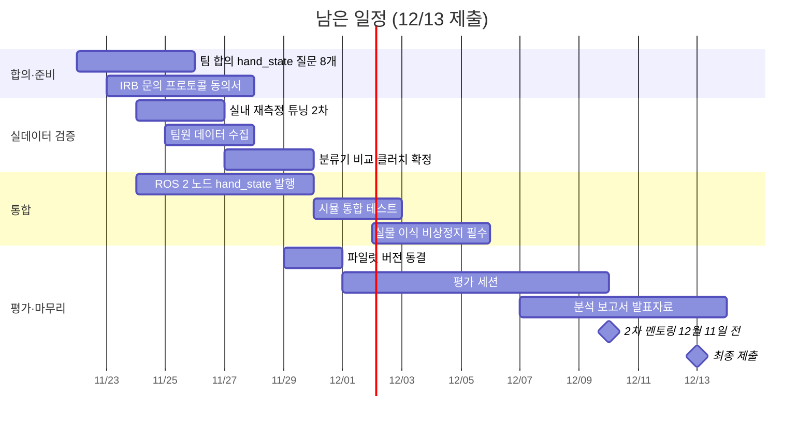

# 전체 흐름과 앞으로 할 일

노션 "P프로젝트 구현 현황" 하위 페이지 **"전체 흐름과 앞으로 할 일"**과 같은 내용을 유지한다.
날짜별 자세한 내용은 `docs/daily_log.md`, 코드 변경은 `docs/implementation_status.md`의 변경 기록.

> **지금 위치** 2026-11-21 · 12주차 · 최종 제출 2026-12-13 23:59까지 22일
>
> 코드(3~8단계)는 준비됐고 첫 실측(야외)으로 규칙을 한 번 다듬었다. 남은 건 **팀 합의 → 실데이터 → 통합 → 평가**. 실데이터 기준으로 계획보다 약 2주 늦어 있고, 가장 큰 걸림돌은 **IRB(외부 참여자 실험 승인)**. 평가 실험은 **12/9까지** 끝내야 한다.

## 지금까지 흐름

| 시기 | 단계 | 한 일과 전환점 |
| --- | --- | --- |
| 9/21 ~ 10/16 | 팀 구성·과제 선정 | 9/21 팀 결성 → 10/7 팀원 휴학으로 4인 → 1차 기업과제(클라우다이크) 계획서 작성·제출 → 10/13 탈락 → **10/16 KETI 과제 매칭** |
| 10/19 ~ 11/7 | 계획·멘토링 | 10/22 1차 회의(역할 분담, LLM 제외) → 10/25 계획서 제출 → 10/26 1차 멘토링 → 11/2 사전발표 피드백(목적 불분명, 약점 하나에 집중) → **11/7 차별점 = 가성비** |
| 11/9 ~ 11/12 | 구현 착수 | 11/10 멘토 승인·OMX-AI와 웹캠 수령 → 11/11 제스처 모듈 3~8단계 코드(가짜 데이터), WSL2 시뮬레이션, 계획·요구사항·실험 문서 → 11/12 첫 커밋 |
| 11/13 ~ 11/20 | 시험기간 소강 | 11/14 회의 취소(각자 진행 공유로 대체), 팀원A Ubuntu 듀얼부팅 계획, 회의 일정 조율 |
| 11/21 ~ | 실측 시작 | 실시간 데모, mediapipe 실행 불가 문제 해결, 야외 첫 녹화 → **튜닝 #1**(문제 5건), 기록 체계(노션·tuning_log) |

**구현 단계 상태** (11/21): 1·2단계 초안·팀 합의 대기 · 3~8단계 코드 완료, 규칙·상태 머신은 1차 실측 반영, 분류기·평가는 실데이터 전 · 9단계(ROS 2) 미착수

**계획과 달라진 점**

- 제출 마감이 12/13이라 계획서 WBS(16주차 보고서)보다 일정을 당겨야 한다
- IRB·실험 프로토콜은 계획서 9주차 일이었는데 아직 문의 전
- 제스처 확정(10주차)·팀원 수집(11주차)이 실데이터 기준으로 밀려 있음. 코드가 먼저 준비돼 있어서 수집만 시작하면 빨리 따라잡을 수 있음

## 남은 일정 한눈에

## 앞으로 할 일과 진행 방법

### 이번 주말 (11/22 ~ 11/23) · 공유와 정리

| 할 일 | 어떻게 | 끝난 기준 |
| --- | --- | --- |
| 오늘 회의 결과 기록 | 로봇팔 사용 일정 답변, 정해진 것을 일일 기록에. 로봇팔 일정에 따라 아래 14주차 실물 이식 날짜 조정 | 일일 기록 11/21에 반영 |
| 단톡 진행 보고 | HANDOFF 7절 초안 + 오늘 결과(데모, 튜닝). 시나리오 영상(D)은 팀 단톡까지만. `/hand/state` 초안과 합의 질문 8개에 **답변 기한(예: 11/25)**을 같이 적기 | 단톡에 올림 |
| 팀 공유 3건 | 손 소실 0.3초 규칙(팀원C 확인), matplotlib 3.10.9, `/hand/state` 합의 | 답변 받음 |
| 커밋 | 많이 쌓인 미커밋 변경을 작은 단위로(규칙·상태 머신 / 데모 / 문서). 팀 저장소는 feature 브랜치 → PR | 작업 트리 깨끗함 |
| IRB 문의 준비 | 월요일에 지도교수님께 메일: "손 좌표만 저장, 영상 미저장, 성인 비침습 실험"이 심의 면제인지, 절차·기간 | 메일 발송 |

### 13주차 (11/24 ~ 11/30) · 실데이터 검증과 노드

팀원들 시험이 11/23에 끝나서 수집·합의가 가능해지는 주. 이 주에 **클러치 확정과 실험용 버전 동결**까지 가야 14주차 평가가 가능하다.

| 할 일 | 어떻게 | 끝난 기준 |
| --- | --- | --- |
| 1. 실내 재측정 | ZIO 웹캠 확보 → `check_env.py --camera 1`(30 FPS, 얼굴 추적 끄기) → 밝은 실내에서 `live_demo.py --camera 1 --record ... --log ...`로 A·B·C·D·E·F 녹화 → CSV 수치 분석 → `tuning_log.md` #2 | 30 FPS, 모든 제스처 신뢰도 0.3 이상 안정, R1~R4 정리 |
| 2. 팀원 데이터 수집 | 팀원 1인 30분. `collect_landmarks.py`로 제스처 + 비조작 5종×4회 + 활성화 시도(call/rock/ok/palm). **IRB가 늦어질 때를 대비해 팀원 중 평가 전용을 미리 지정** | T 그룹 CSV 확보, 평가 전용 팀원 지정 |
| 3. 분류기 비교·클러치 확정 | `train_classifier.py`로 규칙 vs 랜덤 포레스트 vs MLP, `evaluate.py --clutch call/rock/ok/palm`으로 오작동률·활성화 실패율 비교 → `default_roles()` 확정 | 비교표 + 결정 기록 (AI 활용 기록의 "내가 직접 결정한 것"에도) |
| 4. ROS 2 노드 | 합의된 형식으로 `hand_interfaces` 메시지 → `LiveSession`을 감싼 rclpy 노드가 프레임마다 `/hand/state` 발행. WSL2는 웹캠이 어려워서 **녹화 CSV 재생 모드**로 먼저 시험 → 팀원B 명령 생성 노드와 연결 | `ros2 topic echo /hand/state` 동작, 팀원B 노드가 수신 |
| 5. 파일럿·버전 동결 | 팀 외 1~2명으로 평가 세션 리허설(시간·지시문) → 설정값(클러치, 임계값, 모델) 기록하고 git 태그 → 평가 참여자 일정 예약 | 버전 태그, 세션 예약 완료 |

### 14주차 (12/1 ~ 12/7) · 통합·실물·평가

| 할 일 | 어떻게 | 끝난 기준 |
| --- | --- | --- |
| 시뮬 통합 | 손 → 제스처 → 명령 → Gazebo 전체 흐름. 지연 시간 측정(프레임 캡처 시각 기준) | 시뮬에서 조작 시나리오 성공 |
| 실물 이식 | **비상정지 스위치 없으면 실물 구동 안 함**. 로봇팔 사용 일정 확보, 낮은 높이 + 완충재 | OMX-AI가 손동작으로 움직임 |
| 평가 세션 | E 그룹 8명 목표(최소 6명). IRB가 안 되면 팀원 중 평가 전용으로 축소하고 한계를 명시. **세션마다 당일 데이터 확인** | 최소 6명 완료 |

### 15주차 (12/8 ~ 12/13) · 마무리 (수업이 많은 주)

| 할 일 | 어떻게 | 끝난 기준 |
| --- | --- | --- |
| 남은 세션 | 12/9까지 | 실험 종료 |
| 분석 | `evaluate.py`로 E 그룹만 집계. 참여자별 비율 → 평균·95% 신뢰구간, 방식 비교는 Wilcoxon + 효과크기 | 목표(정확도 95%, 오작동 5%, 활성화 실패 10%, 30 FPS, 5ms) 대비 표 |
| 2차 멘토링 | 12/11 전. 증빙(화면·메일 캡처) 보관 | 멘토링 완료 |
| 보고서·발표 | 실데이터 숫자만. 튜닝 과정은 `tuning_log.md`, AI 활용 내역은 `ai_usage_log.md`에서 | 12/13 23:59 제출 |

## 막혀 있는 것과 대비책

| 걸림돌 | 영향 | 대비책 |
| --- | --- | --- |
| IRB 미정 | 외부 참여자 촬영 불가 | 월요일 교수님께 문의. 승인이 14주차까지 안 나면 팀원 대상으로 축소(계획서 5.1 대비책), 평가 전용 팀원은 학습에서 제외 |
| `/hand/state` 미합의 | 팀원B 명령 생성 노드가 멈춤 | 단톡에 초안 + 답변 기한. 미합의 항목은 초안대로 진행하고 나중에 바꾸기 쉽게 |
| 로봇팔 2대를 3팀이 공유 | 실물 이식 일정 | 오늘 회의 답변 기준으로 14주차 사용 기간 확보. 웹캠은 따로 우리가 유지 |
| 비상정지 스위치 없음 | 실물 구동 불가 | 재료비로 구매할지 팀 결정, 담당 정하기 |
| 통합할 Ubuntu 머신 | 전체 흐름 실행 장소가 없음 | 팀원A 듀얼부팅 머신 또는 내 Ubuntu 설치. 그전엔 WSL2 + 녹화 재생 |
| 시간 (15주차 수업 많음) | 분석·보고서 압박 | 실험은 12/9까지, 분석 스크립트는 미리 준비해 숫자만 넣게 |
| 적용 분야 미확정 | 보고서·발표 설득력 | 팀 회의에서 "비접촉이 꼭 필요한 상황" 하나로 확정 (멘토·사전발표 공통 지적) |

## 일하는 방식

1. **시작**: 이 문서와 `implementation_status.md`의 "다음 할 일" 확인
2. **작업**: 코드를 바꾸면 `python -m pytest -q`, 손 동작은 `live_demo.py`로 확인. 녹화는 항상 `--record`와 `--log`를 같이
3. **기록**: 코드·설정 변경 → 변경 기록 / 임계값·규칙 튜닝 → `tuning_log.md` / 그날 한 일 → 일일 진행 기록 / 내가 내린 결정 → `ai_usage_log.md`
4. **커밋**: 작업 단위로 작게, 팀 저장소는 feature 브랜치 → PR
5. **공유**: "팀 공유 필요" 항목은 단톡에 올리고 답변 기한을 함께 적기
6. **데이터 원칙**: 가짜 데이터 숫자는 보고서에 쓰지 않음. 학습에 쓴 참여자로 최종 평가하지 않음. 영상·얼굴은 저장소에 올리지 않음
